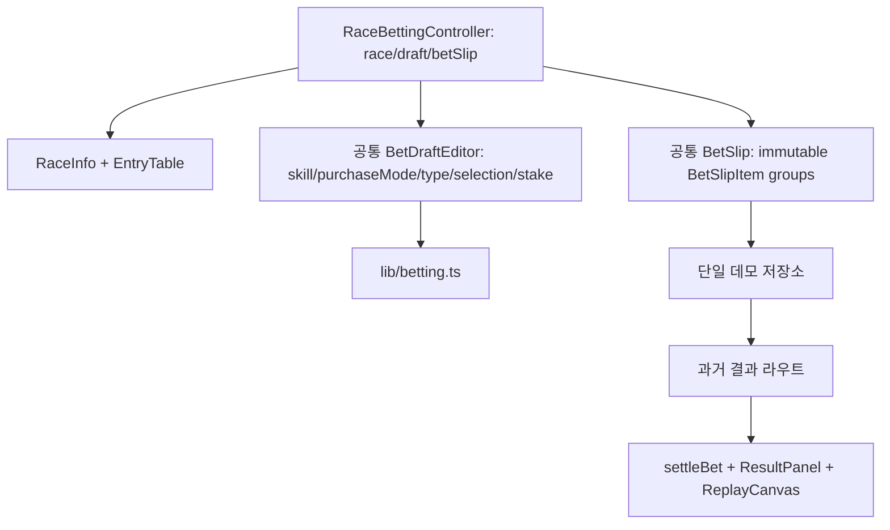

# TRACK:ON 프론트엔드 통합 전략

분석 기준: 2026-11-10, `dev` = `cb003b9`, `feat/betting-screen-trackon` = `d1614b5`, 공통 조상 = `6dd0326`. 이 문서는 두 커밋의 실제 코드를 읽기 전용으로 조사한 구현 계획이다. 두 브랜치와 소스는 변경하지 않았다.

## 1. 목적, 범위, 사실 확인

하나의 Next.js 프론트엔드에서 예정 경주의 베팅 입력과 지난 경주의 블라인드 도전·정산을 제공한다. **두 경주 유형은 동일한 베팅 입력 컴포넌트와 초보자/일반 모드, 개별/조합 구매, 7승식, 마번 선택, 베팅 슬립, 일괄 구매를 공유한다.** 경주 유형별 분기는 데이터 공개 규칙, 결과 확인 시점, 고정 반환율로 제한한다. 베팅 도메인은 기능 브랜치의 승식 규칙·조합 생성·다중 슬립을 기준으로 보존한다. 지난 경주의 정보 표, 결과 패널, 트랙 재생은 `dev`에서 재사용한다. 백엔드·실제 결제·공식 결과 API는 범위 밖이다. 통합 대상 브랜치는 `dev`와 `feat/betting-screen-trackon` 둘뿐이다.

요청의 프로젝트 02 설명과 실제 코드 사이에 차이가 있다. `dev`에는 일반 경주 상세 페이지가 없고 `/challenge/past`의 **블라인드 출전표**가 있다. 마명·기수·결과는 확정 전 숨기고, 상세 기록(최근 5전, 주행 스타일, 전적, 레이팅, 중량, 단·연승 배당)은 표에 보인다. `ResultPanel`은 **별도 라우트가 아니라** `PastRaceGame`의 `settlement` 조건부 영역이다. 별도 결과 화면 이동은 구현 과제다. 기능 브랜치의 `/races/[id]`는 반대로 마명·기수·단승 배당만 있으며 상세 기록은 없다. 기능 브랜치의 완료는 정산 없이 브라우저 잔액을 즉시 차감한다. 이 차이를 데이터 계약과 UX에 반영해야 한다.

```mermaid
flowchart LR
  A[경주 선택] --> B{경주 유형}
  B -->|예정 OPEN| C[/betting/upcoming/{raceId}/]
  B -->|과거 블라인드| D[/betting/pastBlind/{raceId}/]
  C --> E[공통 RaceBettingClient와 데이터 어댑터]
  D --> E
  E --> F[공통 BetDraftEditor · CombinationEditor · BetSlip]
  F --> G[마번과 금액 선택 · 경주 유형별 규칙 적용]
  G -->|다른 항목| E
  G --> H[혼합 슬립 검토 · 일괄 확정]
  H -->|과거| I[별도 결과 화면 · 재생 · 항목별 정산]
  H -->|예정| J[접수 완료 · 결과 대기]
  J -->|결과 확정 시| I
```

## 2. Git 및 구조 분석

| 항목 | `dev` | `feat/betting-screen-trackon` |
| --- | --- | --- |
| HEAD 이후 이력 | `6f01b28` 지난 경주 화면, `a38d90f` 랜딩/대시보드 보존, `000104b` 랜딩 링크, `cb003b9` PR merge | `60663b0` 이관 계획, `d591e3d` 경주 상세, `6817135` 반응형 플로우, `d1614b5` 조합·금액 알고리즘 |
| 독점 경로 | `src/app/challenge/past`, `components/past-race`, `lib/past-race`, `data/mock/past-races.json`, `lib/demo-wallet.ts`, `components/AppHeader*` | `src/app/races/[id]`, `components/betting/RaceBettingClient.tsx`, `lib/betting.ts`, `lib/demoPurchase.ts`, `lib/useDemoState.ts`, `data/races.ts`, `types/racing.ts`, `components/layout/Trackon*` |
| 공통 수정 | `src/app/page.tsx`의 지난 경주 도전 링크, `next.config.ts`의 CSS Module 예외 | `src/app/page.tsx`의 모의베팅 경로/목록, `dashboard/page.tsx`, `globals.css`, `styles/landing.css` |
| 공통 유지 | `/login`, `/tutorial`, `app/layout.tsx`, `styles/styles.css`, 정적 자산 | 동일 |

`git diff --stat dev...feat/...`는 기능 브랜치 쪽 22개 파일, 2,487 삽입·213 삭제다. 역방향은 `dev` 쪽 20개 파일, 18,502 삽입·1 삭제이며 대부분 16,659줄의 지난 경주 JSON이다. 실제 공통 수정 파일은 `src/app/page.tsx` 하나이지만, 대시보드·지갑·헤더·CSS에는 **의미적 충돌**이 있다. `git merge-tree 6dd0326 dev feat/betting-screen-trackon`은 `page.tsx`를 양쪽 수정으로 표시한다. 머지 실행은 하지 않았다. 현 작업 트리에는 기존 `frontend/.gitignore` 수정과 루트 `.gitignore` 미추적 파일이 있으므로 향후 브랜치 작업 전에 소유자 변경사항을 보존해야 한다. `git worktree list`상 현재 worktree는 `dev` 하나다.

## 3. 기술 스택과 충돌 지점

| 항목 | `dev` | 기능 브랜치 | 판단/권장안 |
| --- | --- | --- | --- |
| Next/React | `frontend/package.json`: Next 16.4.3, React 19.3.0 | 동일 파일, 변경 없음 | 버전·lockfile 그대로 유지. 구현 전 `frontend/AGENTS.md`에 따라 설치된 Next 문서 확인 |
| TypeScript | `tsconfig.json`: strict, bundler resolution, `@/*`, JSON import | 동일 | 단일 타입 계약 도입, 설정 변경 불필요 |
| 라우터 | App Router: `/`, `/dashboard`, `/challenge/past` | App Router: `/races/[id]` | 베팅 화면은 `/betting/[kind]/[raceId]` 단일 동적 라우트(`pastBlind`/`upcoming`)로 통합. `/challenge/past`는 과거 경주 선택 진입점으로 보존하고 `/races/[id]`는 통합 URL로 연결하거나 호환 경로로 유지. Pages Router 없음 |
| Tailwind | v4, `globals.css`의 `@import "tailwindcss"` | 동일 | 유틸리티는 새 작은 레이아웃에 보조 사용; 기존 스타일 대량 전환 금지 |
| CSS Modules | `past-race.module.css`, `AppHeader.module.css`; `next.config.ts`에서 모듈을 Turbopack CSS loader에서 제외 | 사용 없음, 설정은 조상본 | `dev` 설정 유지. 모듈 스코프 보존 |
| 전역 CSS/리셋 | `globals.css`가 `landing.css`·`styles.css`·토큰/리셋 import | 같은 구조에 `.dashboard .race-card-actions.single` 추가, `racing.css` 라우트 import | 토큰은 공통화, `.bet-*`는 기능 범위로 제한. 전역 선택자 교차 검증 |
| 폰트/색 | DM Sans·Noto Sans KR·Georgia/Noto Serif KR, `--ink`, `--cream`, `--wine`, `--gold` | 동일 토큰 사용 | 블랙/브라운/웜 아이보리 기반, 와인·골드 강조 유지 |
| UI/상태/애니메이션 패키지 | 없음; React state/useSyncExternalStore, Canvas `requestAnimationFrame` | 없음; React state/useSyncExternalStore | 신규 패키지 불필요 |
| 데이터 | `past-races.json`의 `blind/reveal/stats`, 로컬 지갑 | `data/races.ts`의 합성 경주·출전마, 로컬 구매 | 별도 자료원임을 유지하고 경주 ID/타입 어댑터 정의. 임의 ID 결합 금지 |
| 테스트 | 저장소 내 `dev` 전용 테스트 미확인; `npm run lint/build` | `frontend/tests/{betting,demoPurchase,racingData}.test.mjs`, `scripts/final-check.mjs`, `visual-check.mjs` | Node 테스트 보존·확장, 브라우저 주요 흐름 보강 |
| 빌드 | `next.config.ts`의 `cacheComponents`, Turbopack CSS 조건 | 조상 설정 | `dev`의 CSS Module 조건 보존; 프로덕션 빌드 확인 |

의존성 차이는 `package.json`/`package-lock.json` 기준 **없다**. 별도 Tailwind 설정 파일과 UI 컴포넌트 라이브러리는 확인되지 않았다. `dev`의 Canvas는 `ReplayCanvas.tsx`와 `horseSprite.ts`의 코드 애니메이션이다.

## 4. 기능·컴포넌트 재사용 지도

| 기능 | 현재 위치 | 통합 판단/권장 위치 |
| --- | --- | --- |
| 경주 기본 정보 | 기능 `RaceBettingClient` heading; dev `PastRaceGame` raceHead | 통합·리팩터링: `components/race/RaceInfo.tsx`, 유형별 필드 어댑터 |
| 출전마 정보 표·전적·분석 | dev `components/past-race/EntryTable.tsx`, `Term.tsx`; 기능 컴포넌트 내 단순 표 | dev 표 일부 수정 후 `components/race/EntryTable.tsx`로 이식; 블라인드 공개 필드만 표시. 정보가 없는 예정 경주에는 `-`/미제공 명시 |
| 초보자 질문·일반 승식 | 기능 `RaceBettingClient.tsx`의 `suggestedTypes`, `suggested`, `chooseType` | 하나의 `RaceBettingClient`가 `/betting/[kind]/[raceId]`에서 동작하고 `components/betting/BetTypeSelector.tsx` 및 공통 편집 컴포넌트를 재사용. 계산 로직 재작성 금지 |
| 개별·조합 마번 선택 | 기능 `RaceBettingClient.tsx`의 `selected`, `groups`, `HorseChoices` | 분리·리팩터링: `BetDraftEditor.tsx`, `CombinationEditor.tsx`; 모바일 번호 버튼 신규 |
| 조합 생성·승식 규칙·금액 | 기능 `lib/betting.ts` | 조합 생성은 그대로 재사용; 구매 중복 **거부 검증만** 승인형 정책으로 변경. 7승식, ordered/requiredCount, 1/2/3그룹, 박스, 1+2/2+1, 그룹 내부 동일 조합 제거, 취소마 제거, 1,000조합 생성/100,000P 구매 한도 보존 |
| 베팅 슬립/확정 | 기능 컴포넌트 내 `Slip[]`, `addSlip`, sidebar, `completeDemoPurchase` | 통합·리팩터링: `components/betting/BetSlip.tsx`, `BetSlipItem.tsx`, `lib/demoPurchase.ts`; 항목 ID·그룹 보존, 금액 입력 제거 |
| dev 기존 베팅 슬립 | `components/past-race/BetSlip.tsx`, `PastRaceGame.tsx`의 로컬 `pool/picks/stake/bets` | 입력 UI/마번 버튼 참고 후 `PastRaceGame`의 입력 영역을 공통 `BetDraftEditor`·`CombinationEditor`·`BetSlip`로 연결; 결과/경주 선택 상태만 과거 컨트롤러에 남기고 전환 검증 후 중복 입력 제거 |
| 구매 저장·대시보드 | 기능 `demoPurchase.ts`/`useDemoState.ts`; dev `demo-wallet.ts` | 단일 저장소 어댑터로 통합; 대시보드 기록과 체크리스트 회귀 확인 |
| 결과·정산 | dev `ResultPanel.tsx`, `lib/past-race/{service,settle,types}.ts` | 적중 판정·환불 상태 판정은 재사용, 배당률 기반 지급 계산은 고정 반환율로 교체; 다중 슬립 그룹별/전체 집계 어댑터 추가 |
| 트랙 애니메이션 | dev `ReplayCanvas.tsx`, `horseSprite.ts`, `saddle.ts` | 그대로 이식/재사용. `RevealEntry[]`, 거리, `Venue`와 CSS Module 의존 유지 |
| 헤더·푸터 | dev `AppHeader.tsx`, 기능 `TrackonHeader/Footer.tsx` | 중복 제거; `dev`의 메뉴와 기능 브랜치 포인트 표시를 단일 공통 컴포넌트로 조정 |

기능 브랜치의 UI/로직은 약 1,017줄의 단일 Client 컴포넌트에서 섞여 있다. `lib/betting.ts`와 기존 UI/비즈니스 로직은 필요한 만큼 재사용하고 불필요한 리팩터링을 하지 않는다. 하나의 `/betting/[kind]/[raceId]` 동적 라우트(`kind=pastBlind|upcoming`)가 하나의 `RaceBettingClient`를 사용하고 지난/예정 데이터 어댑터만 경주 자료를 맞춘다. `BlindEntry`와 `RaceEntry` 차이는 어댑터와 공개 가능한 정보로 처리한다. 두 유형 모두 같은 `BetDraftEditor`, `CombinationEditor`, `BetSlip`을 쓰며 베팅 알고리즘·중복 확인 모달은 변경하지 않는다. UI 동작의 공통화 이후에도 정보 공개 규칙·결과 시점·보상 정책은 유형별 계약으로 유지한다. 슬립 격리 키는 `raceKind:raceId`다. **T09B에서 두 어댑터를 통합 라우트에 연결하되 과거 신규 구매는 테스트 전용·실제 포인트 미차감으로 둔다. 기존 `/challenge/past` 선택과 과거 베팅·정산은 T11B 전까지 유지하고, T10·T11·T11A 완료 후 T11B에서 선택 기능이 통합 라우트로 이동시키도록 전환한다. `/races/[id]`는 통합 URL로 연결하거나 호환 경로를 제공한다.**



## 5. 기준 브랜치와 Git 전략

| 전략 | 보존/재사용 | 수정량·위험 | 예상 작업량 |
| --- | --- | --- | --- |
| A 기능 브랜치 기준 + dev 이식 | 베팅 동작을 바로 유지 | `dev`의 과거 경주, 큰 JSON, Canvas, CSS Module, 저장소를 대량 이식; `dev` 최신 랜딩 링크 누락 위험 | 높음 |
| B `dev` 기준 + 기능 이식 | 과거 도전/결과, CSS Module 설정, 현재 랜딩 링크 보존; 기능의 순수 로직·상세 경로를 단계적으로 가져오기 | 1,017줄 UI 추출, 지갑 통합 필요 | 중상 |
| C 양쪽 선별 재설계 | 장기 구조 최적 | 두 기존 화면의 동작을 동시에 재구현할 위험, 회귀 범위 최대 | 매우 높음 |

**B 추천.** Git 기준은 `dev`로 하고, 구현 방식은 기능 브랜치의 `lib/betting.ts`, 경주 상세 라우트·화면, 테스트를 선별 이식한다. 최신 과거 도전과 `next.config.ts`를 보존하기 쉽고, 베팅 알고리즘은 코드 복사가 가능하다. C의 구조 개선은 B 안에서 작은 커밋으로 수행한다. 실제 구현 시 `dev`에서 별도 통합 브랜치를 만들되, 현재 미커밋 변경은 소유자 작업을 보존할 안전한 방법을 먼저 확정한다. 브랜치/커밋은 이번 단계에서 만들지 않는다. 브랜치 생성 후 `git diff --check`, 기능 브랜치의 관련 파일 비교, 각 단계 빌드로 검증한다. 자동 merge는 `page.tsx` 충돌과 의미 충돌을 놓치므로 수동 통합을 계획한다. 이전 단계 커밋을 롤백 지점으로 사용하고 두 원본 브랜치는 유지한다.

## 6. 데스크톱·모바일 UX

데스크톱 1200px 이상은 **경주 기본 정보 왼쪽 상단(B안)**, 출전마 정보 약 62~65%, 오른쪽 베팅 작업 약 35~38%를 시작점으로 한다. 오른쪽은 최소 390px, 전체 컨테이너는 약 1320~1440px가 타당하다. 65:35에 기존 `dev` 340px/기능 330px sidebar를 그대로 넣으면 7승식·조합 그룹·슬립이 좁으므로 390~440px 실측으로 조정한다. 1024~1199px에서는 오른쪽 380px, 1024px 아래에서는 단일 입력 중심 화면으로 전환한다. 표는 왼쪽 내부 가로 스크롤과 열별 상세 접기로 처리한다.

| 스크롤 대안 | 장점 | 문제/판단 |
| --- | --- | --- |
| A 전체 페이지 | 단일 스크롤, 접근성·키보드 안정 | 긴 조합·슬립에서 구매 버튼이 멀다 |
| B sticky 패널+내부 스크롤 | 슬립 접근 쉬움 | 중첩 스크롤·포커스 이동 난도 |
| C 설정/슬립 독립 스크롤 | 각 영역 고정 | 스크롤 3개로 가장 복잡; 비추천 |
| D 단계·접기 | 길이 감소, 단일 스크롤 유지 | 이전 단계 재방문 동선 필요 |

**A+D를 기본**, 데스크톱에서 오른쪽 패널 상단만 `position: sticky; top: 80px`로 제한하고 `max-height: calc(100dvh - 96px)`를 넘으면 sticky를 해제하거나 슬립 요약만 보이게 한다. 패널 자체에 `overflow-y:auto`를 기본 적용하지 않는다. 조합 편집은 넓은 모달(약 720~860px)로 분리하고, 구매 버튼은 오른쪽 슬립 요약 아래에 유지하되 화면 높이가 충분할 때만 sticky footer를 검토한다. 단일 페이지 스크롤 한 개를 우선한다.

모바일(대략 767px 이하)은 경주 요약 → 모드 → 구매 방식 → 승식 → **출전 두수 기반 번호 버튼** → 금액 → `베팅 슬립에 추가`가 주 화면이다. 정보 버튼은 우측 고정, 하단 슬립 바 위 `bottom: calc(베팅바 높이 + env(safe-area-inset-bottom) + 16px)`에 두고 키보드 포커스 중에는 숨기거나 상단으로 재배치한다. `visualViewport`/포커스 시뮬레이션으로 겹침을 검증한다. 정보는 전체 화면 `<dialog>` 또는 라우트 오버레이로 보여주고 선택 토글을 부모 Draft의 동일 액션에 연결한다. 닫아도 Draft·슬립·스크롤 위치를 유지하고 선택 시 자동으로 닫지 않는다. 조합 편집도 모바일 전체 화면이다.

모바일 슬립은 **전체 화면 상세**를 권장한다. Bottom Sheet는 긴 조합/키보드에서 높이 경쟁이 크고 Drawer는 좁다. 하단 고정 요약 바에 항목 수·총액을 보여주고 상세 화면에서 그룹 펼침·삭제·구매 확인을 제공한다. 슬립 상세는 상태를 소유하지 않고 동일 부모 상태를 읽어 닫아도 유지한다. 하단 바 높이만큼 본문 padding을 둔다.

## 7. 입력, 슬립, 상태 계약

`skill`(초보자/일반)과 `purchaseMode`(개별/조합)는 독립 축이다. 두 모드 모두 `BetCombination { betType, selections, unitStake }`를 만든다. 초보자 `suggestedTypes`/질문은 추천 필터이고, 실제 승식은 `BET_TYPES`를 쓴다. 기존 `chooseType`은 선택·그룹·패턴을 초기화하고, 구매 방식 버튼도 조합 진입 시 선택·그룹을 초기화한다. **이미 담은 슬립은 유지**한다. 권장 정책은 모드 전환에서 유효한 Draft의 승식·마번·금액을 유지하고 초보자 필터가 현 승식을 배제할 때만 사용자에게 알리고 선택을 초기화한다. 구매 방식 전환은 두 Draft를 별도 보관하거나 변경 전 경고·복원 정책을 결정한다. 현재 코드의 무조건 초기화는 UX 손실 위험이다.

상태 소유권: `RaceContext`(경주 ID, 유형, 공개 가능한 entries), `BettingDraft`(skill, purchaseMode, betType, selected, groups, pattern, stakeText), `BetSlipItem[]`(ID, mode, betType, 조합 배열의 복사본), `Purchase/Result`(구매 스냅샷과 정산). Draft 변경·모달 개폐·반응형 전환이 슬립을 변경해서는 안 된다. 마번 버튼과 정보 모달은 동일 `selected`/`groups`와 `toggleSelected`/`toggleGroup`를 쓴다. 모달은 컴포넌트를 다시 마운트하며 Draft를 재생성하지 않는다.

**경주 변경 정책:** 작성 중인 Draft와 미확정 슬립을 `raceKind:raceId` 키로 분리한다. 다른 경주로 이동할 때 현재 Draft·슬립을 보관하고 대상 경주의 저장된 상태를 복원한다. 같은 탭의 라우트 이동·새로고침 복원을 위해 버전이 있는 `sessionStorage` 초안 저장을 권장하며, 구매 원장/확정 스냅샷과 분리한다. 복원 시 경주 ID·상태·출전취소·잔액·금액 한도를 다시 확인하고 유효하지 않은 슬립 항목은 구매 불가로 표시해 **삭제 후 재작성**을 안내한다. 구매 확정 후에는 **해당 경주의 미확정 슬립만** 비우고 다른 경주의 Draft·슬립은 유지한다. 슬립 렌더·총액·확인 모달·`validatePurchase`는 현재 경주 키의 항목만 읽는다. 서로 다른 경주의 항목을 한 슬립에 섞거나 여러 경주를 한 번에 구매하는 기능은 이번 범위에서 제외한다.

기능 브랜치 `addSlip`은 `betType:selectionKey`로 **금액과 구매 방식과 무관하게** 중복 추가를 거부하고 `validatePurchase`도 중복 조합을 거부한다. 이는 **확정 정책과 충돌**한다. 통합 후에는 기존 슬립의 동일 승식·마번과 새 항목(개별↔조합 그룹 간 겹침 포함)이 겹치면 확인 모달에 중복 조합 수·금액·총 구매액을 보여준다. 취소하면 추가하지 않고, 승인하면 **별도 `BetSlipItem.id`와 각 조합의 고유 구매 라인 ID**를 가진 항목으로 추가한다. 구매 시에는 승인 사실을 스냅샷에 보존하고, 중복 여부만으로 거부하지 않되 취소마·금액·한도·잔액 검증은 유지한다. 조합 생성 함수가 **한 그룹 내부에서 같은 조합을 한 번만 생성하는 규칙**은 그대로 둔다. 중복 승인 항목은 적중 여부와 반환액을 구매 라인별로 각각 계산하며, 100,000P 한도·잔액 계산에도 반복된 원금을 각각 합산한다. 조합 그룹 내부 조합 단위 삭제는 현재 지원하지 않고 그룹 전체 삭제만 있다. 개별 슬립의 `updateAmount` 입력은 요구사항에 맞춰 읽기 전용 텍스트로 변경한다. `completeDemoPurchase`의 단일 `BetPurchase.mode`는 혼합 정보를 잃으므로 각 항목의 mode/group ID/라인 ID를 스냅샷에 보존한다.

`dev` 지갑과 기능 브랜치 구매는 같은 `trackon-premium-demo-v1` 키를 사용하지만 서로 다른 캐시/이벤트 규칙이다. `demo-wallet.ts`는 모듈 캐시+같은 탭 listeners, 기능 `useDemoState.ts`는 원시 JSON 캐시+`trackon-demo-updated` 이벤트를 쓴다. 한쪽이 쓰면 다른 쪽 화면이 같은 탭에서 낡은 잔액을 볼 수 있다. 단일 저장소 함수와 `useSyncExternalStore` subscribe 경로로 통합하고 기존 `{balance,records,tasks}`와 `records[].purchase?`를 호환해야 한다. **구매 확정 시 `purchaseId`별 전체 원금 `S`를 한 번 차감**하고, 결과 확정 시 `purchaseId`별 반환액 `R`을 한 번 지급한다. 이때 잔액은 `B - S + R`이며 결과 화면의 순수익은 `R - S`다. `purchaseId`에 대한 `debited`/`settled` 기록 또는 동등한 원장 키로 같은 요청의 재시도·새로고침 중복 처리를 막는다. 중복 **승인된 베팅 라인**은 서로 다른 `lineId`로 각각 정산하고, 동일 구매의 **중복 처리**만 차단한다. `dev`의 현재 `applyRound(totalPayout-totalStake)`를 구매 시 차감 이후 그대로 호출하면 원금이 다시 빠지므로 반환액만 더하는 흐름으로 바꿔야 한다. JSON 읽기 실패, 잔액 부족, 다른 탭 변경도 검증한다.

**저장과 복원 계약:** `records.slice(0,20)`은 대시보드에 보여줄 최근 거래 **요약 목록**의 제한일 뿐이다. 구매·결과 화면 복원에 필요한 `purchaseId → {raceKind,raceId,betSlipItems,lineIds,totalStake,debited,settled,resultSnapshot?}`는 별도의 지속 저장 영역에 둔다. 결과가 대기 중인 구매와 결과 페이지에서 참조되는 구매 스냅샷을 20건 표시 제한으로 지우지 않는다. 원장 상태와 잔액·구매 스냅샷은 가능한 한 한 저장 레코드에 함께 기록해 부분 쓰기를 줄이고, 쓰기 성공을 확인한 뒤에만 구매 완료를 표시한다. **기본 보존 정책은 구매 스냅샷 자동 절단 없음, 사용자 명시 삭제만 허용**이며 삭제 전 복원 불가 경고와 내보내기 선택지를 제공한다. 브라우저별 저장 할당량은 고정 수치로 가정하지 않는다. 용량 초과/쓰기 실패 시 성공·차감·지급으로 표시하지 않고 작업을 중단하며 저장 공간 정리/데이터 내보내기 안내를 제공한다. 스냅샷이 삭제·손상되어 결과 화면을 복원할 수 없으면 `purchaseId`를 재구매·재정산하지 않고 복원 불가 상태를 표시한다. 백엔드가 없으므로 삭제된 로컬 구매를 다른 기기에서 복구할 수 없다.

**동시성 한계:** `localStorage`의 단일 `setItem`은 한 탭의 쓰기를 저장하지만, 여러 탭이 잔액을 읽고 각자 수정한 뒤 쓰는 거래 전체에 원자적 비교 후 교체를 제공하지 않는다. 따라서 `purchaseId`/`lineId` 기반 중복 방지, 제출 중 버튼 잠금, 쓰기 직전 최신 상태 재읽기, `storage` 이벤트 동기화, 같은 ID 재요청 무시, 오류 시 실패 처리로 **데모에서 우발적인 중복**을 줄인다. 두 탭의 동시 구매·정산에 대해 완전한 잔액/정산 보장은 주장하지 않는다. 엄밀한 원자성은 향후 서버 원장·트랜잭션이 필요하며 이번 프론트엔드 범위에는 포함하지 않는다.

`data/races.ts`의 `u*/p*` 합성 ID와 `past-races.json`의 과거 실제 표본 ID는 서로 연결되지 않는다. `Race`/`RaceEntry`의 작은 예정 경주 타입과 `BlindRace`/`BlindEntry`/`RaceReveal`의 풍부한 과거 타입을 한 타입으로 억지 합치지 않는다. `RaceView` 어댑터에 `kind: upcoming|pastBlind`, `id`, `display`, `selectableEntries`, `detailsAvailability`를 두고, 과거는 `blind`만 베팅 전에 전달한다. 승식 코드 영어↔한국어 `PoolKey`는 명시적인 7개 매핑으로 변환한다. 합성 예정 데이터에 없는 전적·레이팅을 꾸며내지 않는다. `past-races.json`은 현재 클라이언트 import이므로 결과가 브라우저 번들에 포함된다. **실제 은닉은 백엔드 없이는 보장되지 않는다.** UI/상태 경계에서 reveal을 구매 전 렌더하지 않되, 공정성 보장을 주장하지 않는다.

## 8. CSS·디자인 시스템

| 파일 | 계획 | 위험 |
| --- | --- | --- |
| `src/app/globals.css` | 유지·토큰 정리; 리셋은 1회만 | `button`, `input`, `body.modal-open` 전역 영향 |
| `src/styles/styles.css` | 유지·공통 `.btn`, `.panel`, `.container`, `.badge` 실측 정리 | 기존 랜딩·대시보드·과거 화면 전파 |
| `src/styles/landing.css` | 유지·기능 브랜치 `.race-link`만 필요한 부분 이식 | `dev`의 지난 경주 링크와 기능 브랜치 링크 충돌 |
| `src/app/races/[id]/racing.css` | `.bet-*` 범위로 유지·분할은 나중에 | 전역 import, sticky·모달·media breakpoint 영향 |
| `src/components/past-race/past-race.module.css` | 유지, 정보·결과 추출 시 필요한 규칙만 이관 | 모듈 이름과 global `.panel` 결합 |
| `src/components/AppHeader.module.css` | 유지 또는 공통 헤더로 통합 | 기능 `TrackonHeader` 중복, 포인트 상태 차이 |
| `frontend/next.config.ts` | `dev` 버전 유지 | CSS Module 처리 조건 누락 시 클래스명 문제 |

토큰은 현 `--ink:#25201e`, `--cream:#f7f4ef`, `--paper:#fffdfa`, `--wine:#71192b`, `--gold:#a78651`, `--line:#e6ded5`, serif/sans를 출발점으로 한다. 헤더·버튼·카드·표·입력·dialog의 공통 컴포넌트에만 토큰을 적용하고 기능별 CSS Module 또는 `.bet-page` 범위를 쓴다. `racing.css`는 `.bet-*`가 주이지만 `.bet-page .header-inner` 같은 헤더 결합이 있으므로 헤더 통합 시 제거/이관을 검토한다. `globals.css`의 `body.modal-open`, 네이티브 `<dialog>`, 모바일 fixed 바의 stacking 순서를 명시적으로 정의한다: 콘텐츠 < sticky 헤더/버튼 < 하단 바 < 모달 backdrop/모달. 정확한 z-index 숫자는 구현 시 기존 스타일 조회 후 정한다. Tailwind 유틸리티는 간단한 배치에 쓰고, 구조화된 표·모달·Canvas 스타일은 CSS Module을 우선한다. CSS 전체 재작성은 하지 않는다.

## 9. 결과 화면과 고위험 의존성

현재 호환 흐름은 `/challenge/past`의 경주 선택 → `PastRaceGame.confirm()` → `settleRace()` → `applyRound()` → 같은 페이지 `ResultPanel` 렌더다. T11B 전까지 이 기존 구매·정산 동작을 보존한다. 전환 뒤 `/challenge/past`는 선택 기능을 유지하고 선택한 과거 경주를 `/betting/pastBlind/[raceId]`로 연다. 통합 입력은 `/betting/[kind]/[raceId]`의 단일 `RaceBettingClient`가 맡고, T10/T11의 정산·결과 경로에 구매 스냅샷을 연결한다. `ResultPanel`은 `Settlement { reveal,bets,totalStake,totalPayout }`와 `BlindRace`, `LearningStats`를 받는다. `ReplayCanvas`는 `RevealEntry.checkpoints`, `time`, `distance`, `meet`로 경로를 만든다. `horseSprite.ts`, `saddle.ts`, CSS Module, Canvas 크기/resize, reduced-motion이 의존성이다. 재생 화면은 구매 입력에서 상시 표시하지 않는다.

**경주 순위 및 결과 표시 계약:** `ResultPanel`은 `reveal.entries`를 `pos` 오름차순(순위가 없는 말은 뒤, 동률은 마번순)으로 정렬해 도착 순위·마번·마명·기수·기록(`time`)·착차(`margin`)·출발 200m 순위(`s1fRank`)·막판 600m 기록(`last3f`)을 표시한다. 출전취소·경주제외처럼 `pos`가 없는 말은 상태를 표시한다. 통합 화면에서도 이 순위 표를 결과의 기준으로 유지하고, 재생 중 임시 순위(`ReplayCanvas`의 `order`)와 **확정 도착 순위**를 구분한다. 조합별 적중 판정은 화면의 임시 순위로 계산하지 않고 `RaceReveal.payouts`의 적중 조합과 기존 순서·환불 판정 규칙을 사용한다. 과거 경주는 확정 후 순위·기록·확정 배당 자료·베팅별 **고정 정책 반환액**을 함께 보여준다. 화면의 확정 배당은 경주 정보이며 포인트 지급 배율로 사용하지 않는다. 예정 경주는 확정 결과 자료가 없는 동안 순위와 정산을 표시하지 않는다.

T11 결과/접수 화면은 새 통합 입력 URL에서 구매 ID와 스냅샷을 받아 결과 시점별 화면으로 연결한다. 결과·접수 경로 형식은 `/betting/[kind]/[raceId]`와 구매 스냅샷에 일관되게 연결되도록 T11에서 확정하며, 완료 후 새로고침을 위해 표시 목록과 분리된 구매 스냅샷과 결과를 저장한다. 과거 구매는 승인된 중복도 포함해 슬립 항목을 조합별 구매 라인으로 평탄화 → 기존 적중/환불 판정 → 경주 유형별 반환액 산출 → group ID로 재집계 → 항목별 적중/환불/미적중·반환 → 전체 정산/포인트 변화 순서다. 예정 경주는 구매 접수 후 결과 확정 전 `pending`을 표시하고 정산·재생 링크를 숨긴다. 결과 확정 데이터 공급원은 현재 예정 경주에 없으므로 이 단계의 프론트엔드에서는 결과 대기 상태까지만 보장한다. 과거 블라인드 결과가 새 라우트/스토리지에서 구매 전에 열리지 않도록 UI 접근을 막고, 클라이언트 JSON의 근본적 노출 한계는 기록한다.

### 과거 경주 Mock 결과 데이터 확인 (`dev`)

`frontend/src/data/mock/past-races.json`을 읽기 전용으로 집계했다. 표본은 20경주이고 `blind.entries`와 `reveal.entries`의 마번 집합은 20경주 모두 일치했다. 아래 7개 배당표 배열은 **모든 경주에서 존재하고 비어 있지 않으며**, 항목의 마번은 각 경주 출전표에 있었다. 이는 현재 표본의 적중 조합 판정 자료가 있음을 뜻하며, 향후 자료까지 완전하다는 보증은 아니다.

| 승식 | 결과 데이터 `reveal.payouts` | 20경주 가용성 | 적중 판정 | 환불 처리 |
| --- | --- | --- | --- | --- |
| 단승 | `단승`: 총 20조합 | 20/20, 누락·빈 배열 0 | 마번 1개 일치 | 선택마 상태 우선 검사 |
| 연승 | `연승`: 총 60조합 | 20/20, 누락·빈 배열 0 | 마번 1개 일치 | 동일 |
| 복승 | `복승`: 총 20조합 | 20/20, 누락·빈 배열 0 | 두 마번 정렬 후 일치 | 동일 |
| 쌍승 | `쌍승`: 총 20조합 | 20/20, 누락·빈 배열 0 | 두 마번 순서대로 일치 | 동일 |
| 복연승 | `복연승`: 총 60조합 | 20/20, 누락·빈 배열 0 | 두 마번 정렬 후 일치 | 동일 |
| 삼복승 | `삼복승`: 총 20조합 | 20/20, 누락·빈 배열 0 | 세 마번 정렬 후 일치 | 동일 |
| 삼쌍승 | `삼쌍승`: 총 20조합 | 20/20, 누락·빈 배열 0 | 세 마번 순서대로 일치 | 동일 |

`reveal.entries.status`에는 완주 204, 출전취소 1, 경주제외 2건이 확인됐고 출발제외 사례는 이 표본에서 없었다. `settleBet`은 선택마가 출전취소·경주제외·출발제외이면 배당표 비교보다 먼저 환불로 판정한다. 위 표는 **배당표 존재·마번 유효성** 집계이며 확정 순위와 모든 적중 조합의 정합성을 보증하지 않는다. T02A에서 `reveal.entries.pos`로 만든 확정 1·2·3위와 승식별 적중 조합을 비교한다: 단승=1위, 연승=해당 경주의 입상 범위, 복승=1·2위 비순서, 쌍승=1→2위, 복연승=입상마 두 마리 비순서, 삼복승=1·2·3위 비순서, 삼쌍승=1→2→3위. 출전취소·경주제외·출발제외 말이 적중 조합에 섞이지 않는지, 환불 판정이 먼저 적용되는지, 순위 누락·동착 등 현재 데이터가 표현하지 못하는 경우가 있는지도 감사한다. **승식별 결과 배열 누락·비어 있음, 확정 순위와 적중 조합 불일치, 조합 형식 오류, 필수 결과 미확정**일 때는 `settleBet`의 현재 `(payouts[pool] ?? [])`가 미적중으로 떨어지는 문제가 있다. 데이터 검증 게이트에서 구매에 포함된 **어느 한 승식이라도** 결과가 불완전하면 해당 구매 전체를 `unavailable` 또는 `pending`으로 두고 지급·최종 정산을 보류한다. 부분 지급과 재시도 때의 이중 지급을 피하고 원금 차감 후 임의로 0P 확정하지 않는다. 과거 표본 외 신규 자료와 예정 경주 결과 자료에도 같은 게이트를 적용한다.

### 확정된 포인트 보상 정책과 기존 코드의 차이

| 유형 | 구매 확정 | 적중 시 결과 정산 | 미적중 | 결과 확인 시점 |
| --- | --- | --- | --- | --- |
| 지난 경주 (`dev` 자료원) | 라인 원금 합계 `S`를 1회 차감 | 적중 라인마다 `stake × 1.5`를 반환; 1,000P → 1,500P, 순수익 500P | 반환 0P | 베팅 확정 후 |
| 예정 경주 (기능 브랜치 자료원) | 라인 원금 합계 `S`를 1회 차감 | 실제 결과 확정 뒤 적중 라인마다 `stake × 2`를 반환; 1,000P → 2,000P, 순수익 1,000P | 반환 0P | 실제 결과 확정 후 |

`dev/src/lib/past-race/settle.ts`는 현재 적중 조합을 배당표에서 찾고 `Math.floor(stake * hit.odds)`를 지급한다. `PastRaceGame.confirm()`은 정산 직후 `applyRound(totalPayout - totalStake)`로 **순변화**만 지갑에 기록한다. 기능 브랜치 `completeDemoPurchase()`는 `balance - totalStake`로 구매 원금만 즉시 차감하고 정산은 없다. 새 계약에서는 `settleBet`의 배당표 일치·순서형 정규화·출전제외 환불 **판정**을 재사용하되 `hit.odds`로 지급액을 계산하는 부분을 분리한다. `rewardPolicy(kind)` 또는 동등한 순수 함수가 적중 라인의 고정 반환액을 계산한다. 조합 생성 알고리즘과 적중 판정 규칙은 변경하지 않는다. 배당률은 결과 정보로 계속 표시할 수 있으나 포인트 산식에는 들어가지 않는다. 100P 단위 원금에 150%/200%를 적용하므로 정수 P가 나온다. 모든 라인의 `stake`를 구매 시 합산하고, 결과 시 각 라인의 `returnAmount`를 합산한다. 승인된 동일 조합 두 라인은 같은 적중 결과를 가질 수 있어도 두 원금을 각각 차감하고 두 반환액을 각각 지급한다.

**단계적 정산 전환:** T04A에서는 기존 과거 흐름의 `settleRace → settleBet → applyRound(totalPayout-totalStake)` 계약을 바로 변경하지 않는다. 기존 `settleBet` 시그니처와 배당률 기반 반환값은 T11B 전까지 유지하고 새 고정 반환율 계산은 별도 `classifyOutcome`/`settlePurchase` 경로에 둔다. T09B는 새 `/betting/pastBlind/[raceId]` 경로에 어댑터와 공통 UI를 연결하되 테스트 전용 구매를 사용하고 실제 포인트 차감을 금한다. 기존 `/challenge/past` 선택·베팅·정산은 T11B까지 정상 동작한다. T10 정산, T11 결과/복원, T11A 재생이 완료된 뒤 T11B에서만 `/challenge/past`의 선택 기능을 보존한 채 통합 URL로 진입시키고 새 구매 흐름을 활성화한다. 전환 전후 잔액·기록을 각각 검증하고 실패 시 전환 커밋을 되돌린다.

**구매 전 안내:** 공통 `BetDraftEditor`의 금액/추가 버튼 가까이와 최종 구매 확인 모달에 경주 유형을 표시한다. 지난 경주에는 “적중 시 베팅 포인트의 총 150% 반환(원금 포함), 확정 후 결과 확인”, 예정 경주에는 “적중 시 총 200% 반환(원금 포함), 실제 결과 확정 뒤 정산”을 명시한다. 출전표의 실제 경마 배당률과 모의베팅 포인트 반환율은 서로 다른 라벨·설명으로 구분한다. 확정 후 `ResultPanel`의 확정 배당은 참고 정보로만 표시하고 포인트 반환액 계산에는 사용하지 않는다.

환불은 적중·미적중과 구분한다. 현 `settleBet`은 출전취소/경주제외/출발제외에 원금 100%를 돌려준다. 새 정책은 **환불 반환율을 명시하지 않았으므로**, 기존 원금 반환을 잠정 유지하는 계획으로 기록한다. **T04A 구현 착수 전 사용자 확인이 선행 조건**이다. 미적중에는 추가 지급하지 않는다. 과거의 즉시 정산도 구매 차감과 반환 지급을 별도 원장 이벤트로 처리하며 최종 순변화만 `+0.5 × 적중 원금`처럼 표현한다.

## 10. 미확정 결정과 추천

| 항목 | 대안과 장단점 | 추천·근거 | 난도/사전 결정 |
| --- | --- | --- | --- |
| 패널 너비 | 35%=넓은 정보/좁은 입력; 38~40%=입력 여유/정보 축소 | 최소 390px, 62:38 시작 후 실측 | 중/아니오 |
| 패널 스크롤 | 전체=단순/길다; 내부=짧지만 중첩; 독립=복잡 | 단일 페이지+접기, 제한적 sticky | 중/아니오 |
| 조합 UI | 패널=길다; 넓은 모달=집중/복귀; Drawer=폭 부족; 별도 화면=상태 이동 | 데스크톱 넓은 모달, 모바일 전체 화면 | 중상/아니오 |
| 그룹 내 조합 삭제 | 허용=세밀/그룹·총액 재계산 복잡; 불허=현재 동작 | 불허, 그룹 삭제 후 다시 추가 | 중상/아니오: 기존 동작 기본값 |
| 모드 전환 Draft | 전부 유지=편리/질문 불일치; 초기화=단순/손실 | 유효 Draft 유지, 불일치 시 안내 | 중/아니오: 문서 기본값 |

위 추천은 구현 가능한 기본값이다. **모바일 입력 중심 화면·전체 화면 출전마 정보·하단 요약과 전체 화면 슬립**, 중복 조합 확인 모달→승인 시 별도 항목 보존·개별 정산, 슬립 금액 수정 금지, 혼합 구매, 별도 결과 화면, 유형별 고정 반환율은 확정 사항으로 취급한다. 구현 착수 전 **사용자 결정이 필수인 항목은 T04A의 출전취소·경주제외·출발제외 환불률**이다. 원금 100% 반환은 현재 코드에서 온 잠정안이다.

## 11. Phase, 검증, 롤백

1. **P1 기준선/계약:** 별도 통합 브랜치 준비, 기존 작업 보존, 두 브랜치 테스트·빌드 기준, ID·저장소·결과 상태 계약, **T02A의 20경주×7승식 결과 자료 감사**. 커밋: 계약/데이터 감사 기준선. 결과 누락을 미적중으로 처리하면 진행 보류.
2. **P2 순수 데이터·상태:** `lib/betting.ts`와 테스트 선별 이식, 승식/경주 어댑터, 단일 지갑·20건 표시 목록과 분리된 구매 스냅샷, **T04A 고정 보상 정책**. T04A 전 환불 정책 사용자 확인. UI 이전에 계산·기록 호환과 구매 차감/결과 반환 원장 검증. 커밋: 로직/저장소/보상 정책 별도. 잔액 불일치 시 해당 커밋 롤백.
3. **P3 라우트/화면 골격:** T05는 라우트·공통 프레임, T05A는 CSS·데스크톱/모바일 반응형, T06은 초보자/일반·개별/조합 Draft 추출. 각기 분리 커밋하고 두 모드 축의 독립성을 검증.
4. **P4 정보/조합 편집:** `dev` 정보 표 어댑터, 데스크톱·모바일 정보 화면, 공통 마번 상태, 넓은 조합 편집. 커밋: 정보/조합 각각. 선택 손실 시 롤백.
5. **P5 공통 입력/슬립/구매 준비:** T09는 `raceKind:raceId`로 분리되는 혼합 슬립·중복 확인, T09A는 구매 스냅샷·원금 1회 차감, **T09B는 `/betting/[kind]/[raceId]`에 예정/지난 데이터 어댑터와 단일 `RaceBettingClient` 및 공통 편집기를 연결**한다. 과거 새 구매는 테스트 전용·미차감이며 `/challenge/past`의 선택과 기존 과거 베팅·정산은 계속 기본 동작이다. 각기 분리 커밋.
6. **P6 결과와 전환:** T10은 자료 정합성 게이트와 150%/200% 다중 조합 정산, T11은 통합 라우트에서 시작한 구매와 결과 시점별 화면·복원 연결, T11A는 과거 결과의 `ReplayCanvas` 연결, **T11B는 회귀 검증 후 `/challenge/past` 선택에서 통합 경로로 과거 기본 구매 흐름을 전환**한다. 기존 `/races/[id]`는 통합 URL로 연결하거나 호환 경로로 제공한다. 결과 노출·이중 차감/지급·복원 실패 시 기존 과거 흐름으로 되돌린다.
7. **P7 회귀/마감:** Node 테스트, 타입, ESLint, 빌드, 실브라우저 데스크톱/태블릿/모바일 검증. 커밋: 회귀 수정만 분리. 기존 경로/저장 기록 회귀 시 이전 안정 커밋으로 복귀.

테스트 우선순위: (1) `frontend/tests/betting.test.mjs`의 7승식·순서·그룹/박스·한도와 **그룹 내부 중복 제거 유지**, (2) 20경주×7승식의 확정 순위·적중 조합·출전 상태 정합성과 누락/불일치 시 `unavailable` 처리, (3) 전환 전 `/challenge/past` 기존 입력·배당 기반 정산·잔액/기록 회귀, (4) 경주 A→B→A에서 Draft/미확정 슬립 복원·경주 간 항목 격리·한 경주만 구매, (5) 구매 원금 1회 차감·과거 150%/예정 200% 적중 반환·미적중 0·환불, (6) 저장소 호환/재시도·새로고침의 멱등 처리와 다중 탭 경쟁 한계 기록, (7) 20건 표시 목록을 넘긴 구매 스냅샷 복원·삭제·quota 실패, (8) 동일 조합 확인 모달 취소/승인과 두 라인의 별도 구매·정산, (9) 전환 후 **두 kind URL의 동일 `RaceBettingClient`와 공통 편집기**에서 초보자/일반·개별/조합·7승식·다중 슬립, (10) 정보 모달/직접 마번·닫기·스크롤 유지와 과거 다중 항목 정산/재생·예정 결과 대기. 각 단계 `cd frontend; npm run lint; npx tsc --noEmit; npm run build`와 기존 Node 테스트를 실행한다. 브라우저 수동 검증은 1440/1024/768/390/320px, 긴 슬립·다수 조합·키보드·reduced motion·sticky/fixed 겹침을 포함한다. 설치/빌드는 구현 단계에서만 수행한다.

자세한 세션별 실행 단위, 선행 조건, 완료 메모와 롤백 기준은 [MERGE_TASKS.md](./MERGE_TASKS.md)에 있다.
