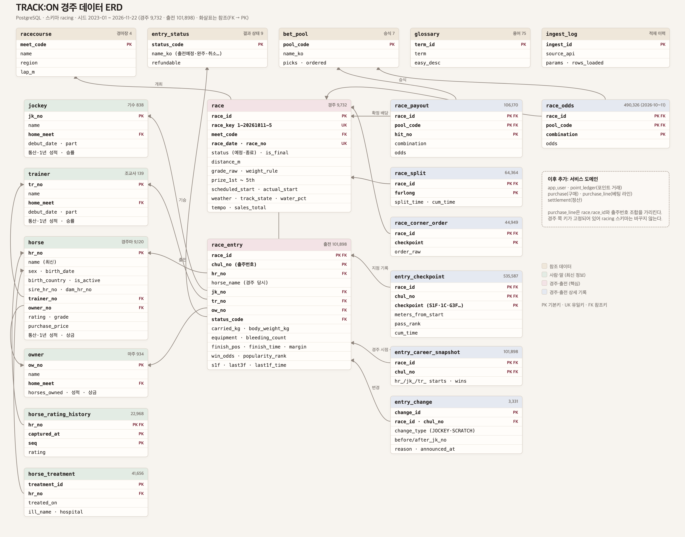
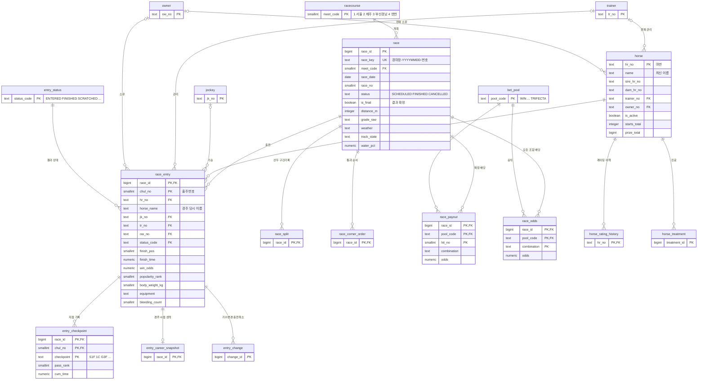
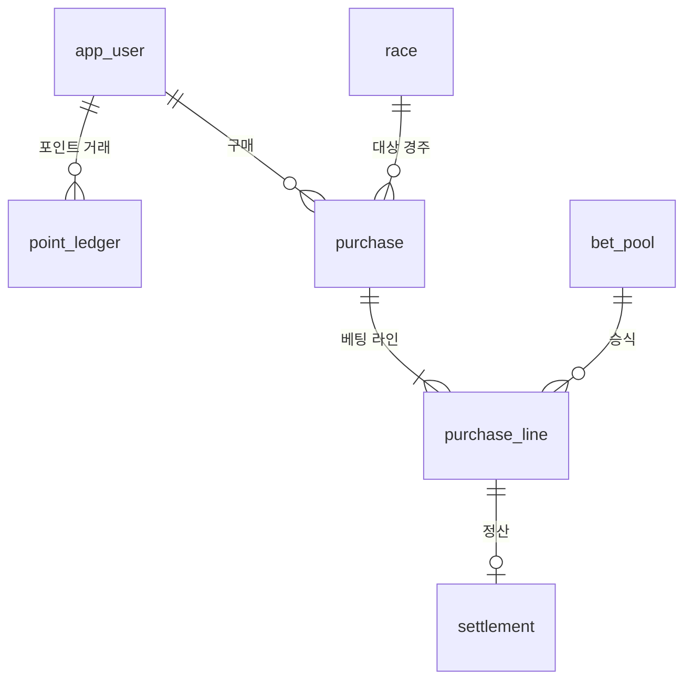

# TRACK:ON ERD (경주 데이터)

범위: 경주 도메인(`racing` 스키마). 사용자·포인트·구매·정산(서비스 도메인)은 로그인·정책이 정해진 뒤 추가한다.
DDL은 `db/init/01_schema.sql`, 실행 방법은 `db/README.md`에 있다. 기능별 데이터는 `docs/feature-list.md`, 원천 API는 `docs/kra-api-plan.md` 참고.

## 테이블

| 테이블 | 한 행의 의미 | 행 수(시드) | 원천 API |
|---|---|---:|---|
| `racecourse` | 경마장 | 4 | 코드 |
| `bet_pool` | 승식 | 7 | 코드 |
| `entry_status` | 출전 상태(출전예정·완주·취소 등) | 9 | 코드 |
| `glossary` | 입문자용 용어 | 75 | 자체 작성 |
| `race` | 경주 1건 (예정·종료) | 9,732 | 경주개요 API3_1, 결과종합 API299, 경주계획표 API72_2, 경주로정보 API189_1 |
| `race_entry` | 경주 × 출전마 | 101,898 | 경주성적정보 API214_1, 출전표 API26_2, 마체중 API25_1, 장구·폐출혈 API24_1 |
| `entry_checkpoint` | 경주 × 출전마 × 지점 | 535,587 | 경주성적정보 API214_1 (경마장별 필드 통일) |
| `entry_career_snapshot` | 경주 × 출전마 (경주 시점 통산 성적) | 101,898 | 결과종합 API299, 출전표 API26_2 |
| `race_split` | 경주 × 200m 구간 (선두 기준) | 64,364 | 구간별 성적 API6_1 |
| `race_corner_order` | 경주 × 지점 (통과 순서 원문) | 44,949 | 코너별순위 API303 |
| `race_payout` | 경주 × 승식 × 적중 조합 | 106,170 | 요약성적표 API34_1 |
| `race_odds` | 경주 × 승식 × 모든 조합 | 490,326 (2026-10~11) | 확정배당율 통합 API160_1 |
| `horse` | 경주마 | 9,120 (현역 4,056) | 경주성적정보, 경주마 상세 API8_2 |
| `jockey` / `trainer` / `owner` | 기수 / 조교사 / 마주 | 838 / 139 / 934 | 경주성적정보, API12_1·API11_1 / API19_1 / API14_1 |
| `entry_change` | 기수변경·출전취소 1건 | 3,331 | API10_1, API9_1 |
| `horse_rating_history` | 말 × 레이팅 수집일 | 22,968 | API77 |
| `horse_treatment` | 진료 1건 | 41,656 (최근 출전마 1,609두) | API141 |
| `ingest_log` | 원천 API 적재 이력 | 30 | 적재 스크립트 |

시드 데이터: 2023-01-06 ~ 2026-11-22. 확정 경주 9,706개, 예정 경주 22개(시드 생성 시점에 아직 달리지 않은 당일 경주).

## 설계 결정

1. **경주 식별자:** 내부 키는 `race_id`(숫자), 외부에 노출하는 키는 `race_key`(`경마장-YYYYMMDD-번호`, 예: `1-20261011-5`). 둘 다 유일하다.
2. **출전마 식별자:** `(race_id, chul_no)`. 출주번호는 그 경주 안에서만 쓰는 등번호라서 말 자체는 `hr_no`로 가리키고, `(race_id, hr_no)`도 유일하게 둔다.
3. **이름은 두 군데:** 마번 393두, 마주 16명, 조교사 1명이 기간 중 이름이 바뀌었다. 마스터(`horse` 등)는 최신 이름, `race_entry`는 경주 당시 이름을 저장한다.
4. **기수·조교사·마주 번호:** 전국에서 유일하고 여러 경마장에서 활동하므로 경마장을 키에 넣지 않는다. 가장 많이 활동한 경마장을 `home_meet`로 둔다.
5. **결과 상태 코드화:** 마사회 `ordBigo` 원문(출전취소 등)을 `entry_status` 코드로 바꾸고, 모의베팅 환불 여부(`refundable`)를 함께 둔다.
6. **경주 전 정보와 결과의 분리:** 블라인드 모의베팅이 결과를 미리 노출하지 않도록 경주 시점 통산 성적은 `entry_career_snapshot`에 따로 둔다. 예정 경주는 `race.status = 'SCHEDULED'`, 결과 컬럼이 비어 있는 상태로 들어온다.
7. **0은 값 없음:** 마사회 API가 "없음"을 0으로 주는 필드(레이팅, 구간 기록 등)는 NULL로 바꿔 저장한다.
8. **조회 시점 성적:** 기수·조교사·마주·경주마의 통산·1년 성적은 API 조회 시점 값이라 마스터에 두고 `stats_at`에 수집일을 남긴다. 블라인드 화면에는 경주 시점 값(`entry_career_snapshot`)만 쓴다.
9. **모든 조합 배당은 따로:** `race_payout`은 적중 조합만(정산용), `race_odds`는 모든 조합(학습용 "이 조합이었다면")이다. `race_odds`는 양이 많아 최근 2개월만 시드에 넣는다.
10. **새 테이블 최소화:** 경주로 정보(날씨·함수율)는 경주별 값이라 `race`에, 장구·폐출혈은 출전별 값이라 `race_entry`에 컬럼으로 넣었다.

## 이후 추가할 서비스 도메인 (참고)

구매 라인은 `race.race_id`와 출주번호 목록(조합)을 가리킨다. 경주 쪽 키가 위처럼 고정되어 있어 서비스 테이블을 추가할 때 `racing` 스키마는 바꾸지 않아도 된다.
